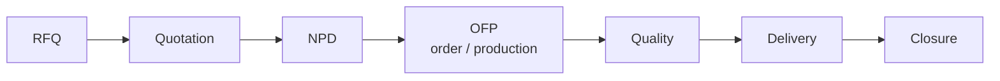
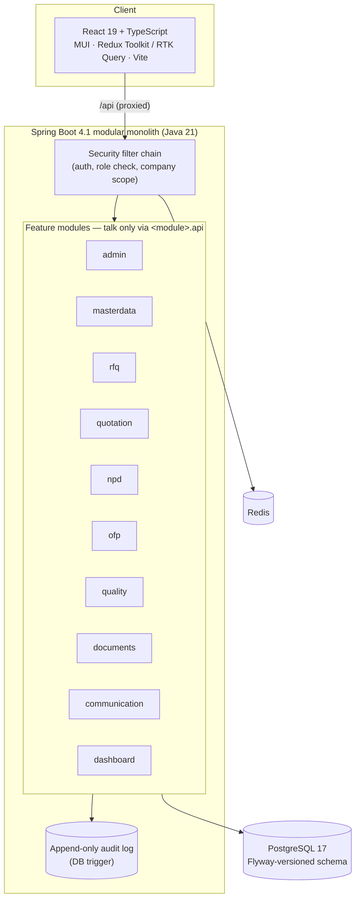
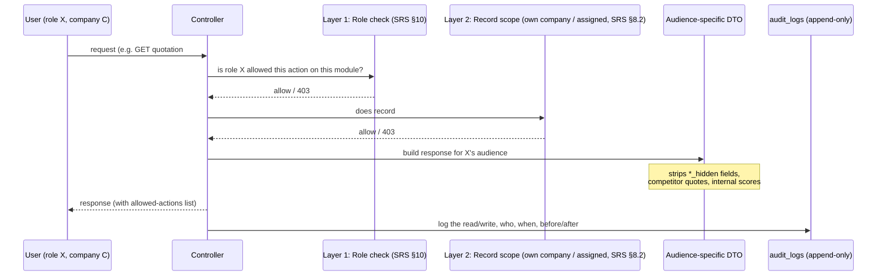
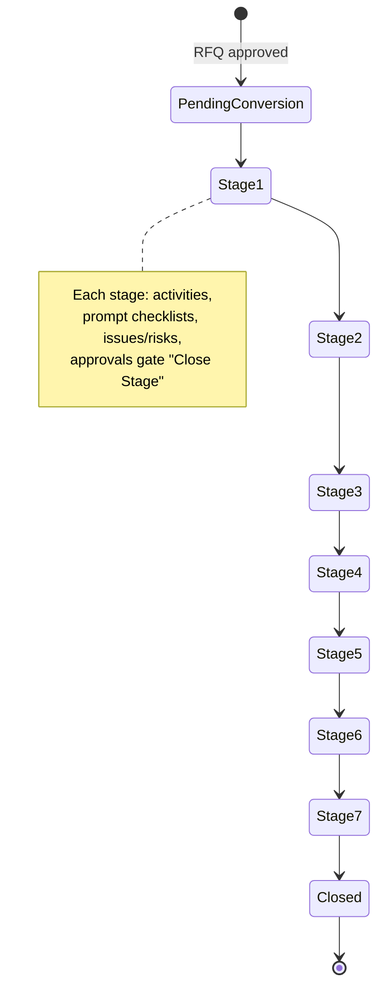

# ERGO Connect

A digital collaboration platform that connects **ERGO**, its **customers** and its **suppliers** across the sourcing lifecycle — from first RFQ to final closure — under one system with two-layer access control (role + company/record scope). It handles financial, quality and compliance data, so correctness and access control come before speed.



## Who uses it

| Org type | Examples of role | Sees |
|---|---|---|
| **ERGO** | Admin, Management, RFQ/Sales, KAM, Quality, Production | everything in scope of their role + assigned accounts |
| **Customer** | Buyer | their own company's RFQs, quotes, NPD projects, orders — never suppliers, never competitor quotes |
| **Supplier** | Sales | RFQs floated to them, their own quotes — never the customer, never other suppliers' quotes |

18 roles total across the three org types (see `docs/SRS.md` §9 for the full list).

## Architecture at a glance



`ModuleBoundaryTest` fails the build if a module reaches into another module's internals instead of its `api` package — this is how the modular monolith stays modular.

## Two-layer access control

Every request is checked twice before data comes back: **can this role do this action**, then **does this record belong to this user's company / assignment**. Hiding fields in the UI is never the protection — separate DTOs per audience keep hidden data (competitor quotes, target prices, ERGO margins, internal notes/scores) out of the response entirely.



Every response also carries the caller's allowed actions (computed by the same checks that enforce them), so the UI only ever renders buttons the user can actually use.

## NPD workflow example (9 stages)

RFQ → NPD conversion is manual — approval only queues the RFQ for conversion, someone still has to convert it.



## Repo layout

| Path | What |
|---|---|
| `ARCHITECTURE.md` | Architecture, security plan, build phases, **decisions log (§8)** |
| `docs/SRS.md` | Software Requirements Document (Markdown conversion of the .docx) — business rules, permissions, workflow states, DB tables, API |
| `ergo-connect-backend/` | Java 21 · Spring Boot 4.1 · PostgreSQL 17 · Flyway: modular monolith |
| `ergo-connect-frontend/` | React 19 · TypeScript · MUI · Redux Toolkit / RTK Query · Vite |
| `.claude/agents/` | Claude Code agents used to build this repo: `srs-analyst`, `db-migration-author`, `backend-module-builder`, `frontend-feature-builder`, `security-reviewer` |
| `ergo-connect-mvp/` | Early UI demo (reference only, not part of the build) |

## Prerequisites
JDK 21 (`JAVA_HOME` must point to it) · Node 24 · Docker Desktop (running)

## Run locally
```bash
# 1. dependencies (Postgres + Redis)
cd ergo-connect-backend
docker compose -f docker/docker-compose.local.yml up -d

# 2. backend → http://localhost:8080  (API docs: /swagger-ui.html)
./mvnw spring-boot:run

# dev demo users (password ErgoDev#2026): admin@ergo.dev, management@ergo.dev, rfq@ergo.dev, kam@ergo.dev,
# buyer@acme.dev, sales@precision.dev …

# 3. frontend → http://localhost:5173  (proxies /api to the backend)
cd ../ergo-connect-frontend
npm install
npm run dev
```

## Test
```bash
cd ergo-connect-backend && ./mvnw verify          # needs Docker (Testcontainers)
cd ergo-connect-frontend && npm run lint && npm run build
```
CI (GitHub Actions) runs both on every push.

## Containers

`ergo-connect-backend/Dockerfile` and `ergo-connect-frontend/Dockerfile` build production images (backend: JRE 21 Alpine, non-root, defaults to the `prod` profile; frontend: static build served by non-root nginx, reverse-proxying `/api` to the backend container so the bundle never hardcodes a backend URL).

```bash
docker compose build          # both images
docker compose up -d          # local smoke-test stack: Postgres/Redis/ClamAV + both images, backend on the dev profile
docker compose down
```
The root `docker-compose.yml` is for local verification only — it is not the deployment manifest (8k provisions the real Azure infra).

## Deploy configuration (prod profile)

All secrets and environment-specific config come from env vars only — nothing is committed (`application-prod.yml`). Required to run with `-Dspring.profiles.active=prod`:

| Var | Purpose |
|---|---|
| `DB_URL` | Postgres JDBC URL |
| `DB_USERNAME` | Postgres username |
| `DB_PASSWORD` | Postgres password |
| `JWT_SECRET` | ≥32 random bytes; app refuses to start otherwise (`SecurityProperties`) |
| `CORS_ALLOWED_ORIGINS` | comma-separated allow-list — never `*` |
| `REDIS_URL` | `rediss://:<access-key>@host:6380` (TLS — Azure Cache for Redis disables the plaintext port) — backs the login rate limiter |
| `FRONTEND_BASE_URL` | origin the password-reset email links point to, e.g. `https://app.ergoconnect.example` |
| `MAIL_HOST` / `MAIL_PORT` / `MAIL_USERNAME` / `MAIL_PASSWORD` | SMTP credentials for password-reset email — the app refuses to start without them (`RequireMailInProd`); never falls back to logging a live reset link in prod |
| `MAIL_FROM` | the `From:` address on password-reset email — must pass the domain's SPF/DMARC |
| `AZURE_STORAGE_CONNECTION_STRING` | Azure Blob Storage connection string for document bytes — the app refuses to start without it (`AzureBlobDocumentStorage`) |
| `AZURE_STORAGE_CONTAINER` | optional, defaults to `documents` |
| `CLAMAV_HOST` / `CLAMAV_PORT` | optional, default `localhost:3310` — the ClamAV sidecar every upload is scanned against before it's stored; override once 8k/8l deploy the real sidecar |

One-time only, for the very first deploy against an empty database — unset both afterwards:

| Var | Purpose |
|---|---|
| `ERGO_BOOTSTRAP_ADMIN_EMAIL` | creates the first ERGO Admin login on startup if no company exists yet |
| `ERGO_BOOTSTRAP_ADMIN_PASSWORD` | its temporary password (≤72 bytes, bcrypt's limit) — the account must change it on first login |

CI-only secret: `NVD_API_KEY` (GitHub repo secret, not an app env var) turns on the Dependency-Check CVE gate — optional, CI skips it with a `::warning::` when unset.

## Non-negotiables

- Two-layer access control, enforced server-side (see diagram above) — never just hidden in the UI.
- Approval rights are separate from edit rights.
- Status changes go only through the module's workflow service; reopen/reject/send-back require a reason.
- Every write is audited; critical records are versioned; `audit_logs` is append-only.
- RFQ → NPD conversion is manual, never automatic on approval.
- Currency is tagged on every money row (INR/USD/EUR/RMB).
- Flyway migrations are immutable once committed — changes ship as a new `V<n>__` migration.

## Status

- [x] Phase 0: foundation (scaffold, security shell, append-only audit log, module-boundary test, CI)
- [x] Phase 1a: login, one active role per session, company-scoped access, user/company admin, audit trail
- [x] Phase 1b: master data (currencies, materials, processes, coatings, payment terms, incoterms) + customer/supplier management with approval, KAM account scope, self-service company profile
- [x] Phase 2a: RFQs: create (customer or ERGO), process flow, drawings with visibility, ERGO review, clarification, validation, audit trail
- [x] Phase 2b: supplier float (invite with due date), supplier quotes (tooling lines, cost breakdown, own process route), clarification, regret, re-open with reason, immutable versions with a change view, RFQ close
- [x] Phase 2c: exchange rates, quote comparison (converted prices, best-value highlighting, scores, shortlist/select), quotes to the customer (supplier quote as-is or ERGO quote with hidden margin), customer approve/revise/decline
- [x] Phase 3a: NPD — manual RFQ→NPD conversion queue, 9-stage workflow (Pending Conversion → Closed), stage history, ERGO-only activities with mandatory-gate on Close Stage, project edit (owner, risk, sample dates)
- [ ] Phase 3b: NPD supplier/customer participation
- [ ] Phase 4: OFP
- [ ] Phase 5: Quality
- [ ] Phase 6: Documents + Communication
- [ ] Phase 7: Dashboards + audit refinement
- [ ] Phase 8: hardening / deploy

See `ARCHITECTURE.md` §6 for the full build order and rationale.
