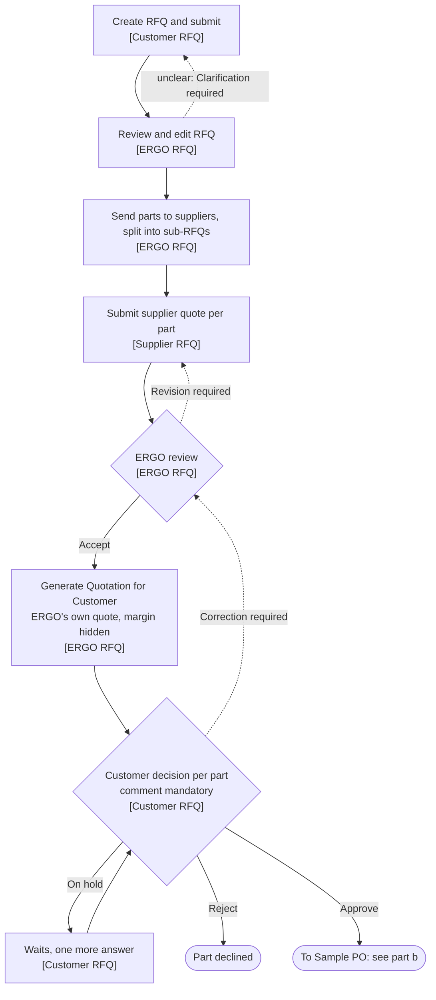
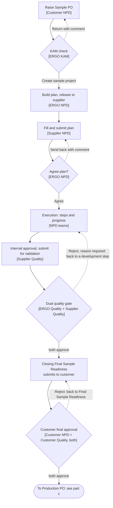
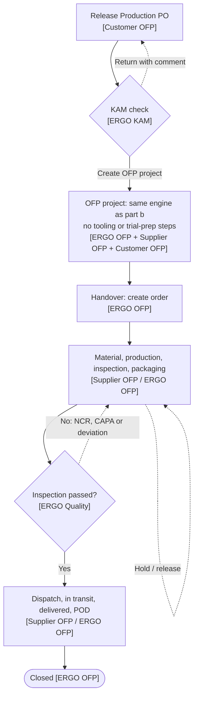
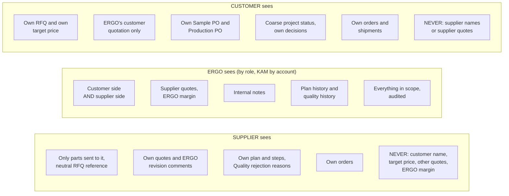

# ERGO Connect — Project Guide

State of branch `sprint-5-demo` (HEAD `e32d571`, 2026-11-09, in sync with `origin/sprint-5-demo`). Written from `CLAUDE.md`,
`docs/FLOW_ALIGNMENT.md`, `docs/PERMISSIONS.md`, `ARCHITECTURE.md` §8, `deploy/README.md`, `docs/READINESS_8Q.md`,
`docs/SECURITY_PASS_8P.md`, the git history and the code. Anything I could not confirm is in **Open questions** (end).
Where the client flow document and the SRS differ, **the flow document wins** (`docs/FLOW_ALIGNMENT.md` §1).

---

## 0. 30-second summary

**ERGO Connect** is one web platform where **ERGO** (a sourcing company), its **customers** (who need parts) and its
**suppliers** (who make parts) run the whole path from "I need this part" to "the order is delivered and closed".
It handles prices, quality and compliance data, so **access control comes before speed**.

Lifecycle:

**RFQ → Quotation → Sample PO → Plan → Execution → Quality gate → Final approval → Production PO / OFP → Delivery → Closure**

| Fact | Value |
|---|---|
| Org types | ERGO, Customer, Supplier |
| Roles | 18 (17 active; `CUSTOMER_MANAGEMENT` is inactive in the MVP) |
| Key rule | The customer never sees the supplier. The supplier never sees the customer, competitor quotes or ERGO margins. |
| Stack | Java 21 + Spring Boot 4.1.2 + Postgres 17 + Redis + Flyway · React 19 + TypeScript + MUI 9 + RTK Query |
| Production target | One Oracle Cloud VM (**not Azure**). Malware scanning is off by client decision. |
| Latest migration | `V44` (`V44__rfq_new_format.sql`) |

---

## 1. Beginner walkthrough

### 1.1 Glossary (read this first)

| Term | Meaning |
|---|---|
| **ERGO** | The middle company. It sits between customers and suppliers, checks everything and controls who sees what. |
| **Customer** | A company that wants parts made (example: *Acme Automotive*). |
| **Supplier** | A factory that makes the parts (example: *Precision Castings*). |
| **Part / part number** | One item to be made. One request can list many parts. |
| **RFQ** | *Request For Quotation.* The customer asks "what would you charge to make these parts?" |
| **Quotation / quote** | A price offer. Two kinds here: the **supplier quote** (what the factory charges ERGO) and the **customer quotation** (what ERGO offers the customer). They are different documents. |
| **Sub-RFQ** | ERGO splits one RFQ into groups of parts and sends each group to a different supplier. |
| **Margin** | ERGO's profit on top of the supplier price. Hidden from customers and suppliers. |
| **Target price** | The price the customer hopes to pay. Never shown to suppliers. |
| **EAU** | *Estimated Annual Usage.* How many pieces the customer expects to buy per year (field `eau`). |
| **PO** | *Purchase Order.* A formal "yes, make it" from the customer. |
| **Sample PO** | A PO for a few **sample** pieces, to prove the part can be made. |
| **Production PO** | A PO for the **real volume** after the sample is approved. |
| **NPD** | *New Product Development.* The project that turns an approved quote into approved samples. |
| **OFP** | Order / production phase: making and shipping the real order. (The repo calls this module `ofp`; the docs say "order, production tracking, dispatch".) |
| **KAM** | *Key Account Manager.* The ERGO person who owns a customer's account. Sees only their assigned accounts. |
| **Plan / plan template** | The list of steps (material arrival, tooling ready, sample date, packaging…) the supplier must date and commit to. |
| **Quality gate** | A check that must pass before the project or order moves on. |
| **Inspection** | A quality check of parts. Result: passed, rejected or released with deviation. |
| **NCR** | *Non-Conformance Report.* "This part does not meet the requirement." |
| **CAPA** | *Corrective And Preventive Action.* The fix for an NCR, and how to stop it recurring. |
| **Deviation** | A written permission to ship parts that are slightly out of spec. Can need customer approval. |
| **Hold** | Stop the item for now without ending it. |
| **MVP** | *Minimum Viable Product.* The first release scope (SRS §16). |
| **SRS** | *Software Requirements Specification.* The original requirements document. |
| **RBAC / scope** | Role check (what your job may do) + record scope (which records are yours). |
| **NV / V / A / O** | Access levels: No access / View / Act / Owner (includes final approval). |
| **2FA / OTP** | Second login factor: an emailed code. |
| **CI / CVE** | Automated build checks / a publicly known security hole. |

### 1.2 The story: one part, from request to closed order

**The part:** a cast aluminium housing, part number `HSG-100`. **Cast of characters:** Acme (customer), ERGO, Precision
Castings (supplier).

| # | What happens | Who acts | Where in the app |
|---|---|---|---|
| 1 | Acme needs 5,000 housings a year. Its RFQ team creates an **RFQ**: a title, a date by which it wants prices, a currency, and a table of parts (part number, description, EAU, drawings, target price). It submits. One RFQ can hold many parts. | **Customer RFQ** | `/rfqs/new` |
| 2 | ERGO RFQ reads it. If something is unclear it asks Acme to fix it (**Clarification required**). It fills in the technical details the customer left out. | **ERGO RFQ** | `/rfqs/:id` |
| 3 | ERGO picks suppliers from its own list and **sends the part** to Precision. With many parts it can split them into **sub-RFQs** (e.g. machined parts to one factory, castings to another). Files are shared **per part**, only to the supplier holding that part. Precision sees a neutral reference like `RFQ-2026-00123`, never Acme's name or RFQ number. | **ERGO RFQ** | Quotes panel |
| 4 | Precision prices `HSG-100` and **submits** its supplier quote with remarks. | **Supplier RFQ** | `/quotes/:id` |
| 5 | ERGO reviews it. Too high? **Revision required**: back to Precision with comments. Fine? **Accept**. | **ERGO RFQ** (O-level role) | Parts panel |
| 6 | ERGO presses **Generate Quotation for Customer**. The system builds ERGO's *own* quote (with ERGO's hidden margin) in the customer's format. The supplier quote is never forwarded. Both are kept for history. | **ERGO RFQ** | Generate dialog |
| 7 | Acme reviews its quotation and decides **per part**: **Approve**, **Correction required** (back to ERGO), **Reject**, or **On hold** (decide later). Every decision needs a comment. | **Customer RFQ** (approving role) | Customer quotation tab |
| 8 | Approved. Acme's NPD team raises a **Sample PO** for `HSG-100` and submits it to ERGO's KAM. | **Customer NPD** | `/npd/sample-pos` |
| 9 | The KAM checks it. Wrong? **Return** with a comment. Right? **Create the sample project** and assign an ERGO NPD person and an ERGO Quality person. | **ERGO KAM** | Sample PO detail |
| 10 | ERGO NPD builds the **plan** (steps and what is needed) and **releases it to the supplier**. Until then the supplier cannot see the project at all. | **ERGO NPD** | Project, Plan panel |
| 11 | Precision's NPD team fills in dates and owners for its steps and **submits the plan**. ERGO NPD **agrees** or **sends it back** with a comment. Only after agreement can work start. | **Supplier NPD**, **ERGO NPD** | Plan panel |
| 12 | **Execution.** The teams work the steps (planning, sourcing, tooling and material, trial prep, trial run, final sample) and mark them done. The project shows progress. | **Supplier / ERGO / Customer NPD** | Activities tab |
| 13 | **Quality gate.** Supplier Quality inspects and approves internally, then both **ERGO Quality** and **Supplier Quality** must approve. If ERGO Quality rejects (reason required), the project goes back to a development step for rework. | **Supplier Quality**, **ERGO Quality** | Validation panel |
| 14 | **Customer final approval.** Closing "Final Sample Readiness" sends it to Acme. **Both Customer NPD and Customer Quality** must approve. A rejection returns it to final sample readiness with comments. | **Customer NPD, Customer Quality** | Validation panel |
| 15 | Samples are approved. Acme's OFP team releases the **Production PO** (real volume). The KAM is notified, then **returns** it or **accepts** it by creating the **OFP project**, assigning an ERGO OFP and an ERGO Quality user. | **Customer OFP**, **ERGO KAM** | `/ofp/production-pos` |
| 16 | The OFP project runs like NPD but **without** the tooling and trial-preparation steps. Customer OFP and Supplier OFP join. Same plan, execution, dual quality gate and customer approval. | **ERGO OFP**, **Supplier OFP**, **Customer OFP** | `/npd/:id` (kind = production) |
| 17 | An **order** is created from the production project ("handover"). It moves: material ordered → received → production started → inspection → packaging. | **ERGO OFP**, **Supplier OFP** | `/ofp/:id` |
| 18 | **Dispatch is blocked until the inspection has passed.** Then dispatch-ready → dispatched → in transit → delivered. Proof of delivery (POD) is uploaded. | **Supplier OFP**, **ERGO OFP**, **ERGO Quality** | Order page, shipments |
| 19 | If a part fails: **NCR** → containment → root cause → **CAPA** → closure. A **deviation** can let slightly-off parts ship, with approval. | **Quality roles** | `/quality/*` |
| 20 | Delivery confirmed, the order is **closed**. | **ERGO OFP** | Order page |

Always on, in the background: **Management** watches dashboards and approves major decisions; **Admin** manages users,
companies, permissions and master data; every write is in the **audit log**.

---

## 2. Flow diagrams

### 2.1 Lifecycle with decision points

Each box names its owner in `[brackets]`. Dashed arrows are loop-backs (send-back, correction, reject, reopen). The
lifecycle is drawn in three parts: **(a)** quotation, **(b)** sample project, **(c)** production and delivery.

**(a) RFQ and Quotation**



**(b) Sample PO, plan, execution and quality gates**



**(c) Production PO, OFP project, delivery and closure**



Reopen: an accepted quote can be taken back or sent for revision by an O-level ERGO role; an inspection or NCR can be
reopened with a reason. Every send-back, reject and reopen **requires a reason** (CLAUDE.md non-negotiables).

### 2.2 Who sees what



Enforced by **separate DTOs per audience** (chosen by `companyType`, not by role) — fields are not nulled, they do not
exist in the other audience's type. Examples: `SupplierRfqItem` (carries `supplier_ref`), `CustomerItemView`.

---

## 3. What changed on `sprint-5-demo`

`origin/main` is 165 commits behind this branch; `origin/sprint-3` is 35 commits behind (there is no local `main`).
The 35 commits since `sprint-3` fall in four groups. Dates are commit dates.

### 3.1 RFQ new format and customer-facing changes (2026-11-09, newest)

| Commit | Feature | What it does | Files / migration | Who sees it |
|---|---|---|---|---|
| `cf67413` | **Client's revised RFQ entry (V44)** | One create screen: header (title, expected quote date, currency, description, special instructions) + one scrollable part table (part #, description, EAU, four attachment slots, target price, remarks). Save-draft and Submit from the same page. Numbers become `PREFIX-YEAR-SERIAL` (`IC-2026-001`). Old technical fields stay in the DB; ERGO fills them during review, so the "complete" check moved from customer submit to ERGO distribution. | `V44__rfq_new_format.sql` (adds `rfqs.title/description/special_instructions/supplier_ref`, `rfq_items.remarks`, `companies.rfq_prefix`, `rfq_number_counters`, `rfq_item_files`, currencies GBP/AUD/CAD). Backend `rfq/domain/RfqService.java`, `RfqAttachmentRules.java`, `FileKind.java`; `masterdata` `Directory.rfqPrefix`. Frontend `features/rfq/pages/RfqEditPage.tsx`, `components/AttachmentCell.tsx`. Tests `RfqNewFormatTests`, `RfqItemFileTests`. | Customer (create), ERGO (review, sets prefix in company dialog) |
| `cf67413` | **Neutral supplier reference** | `rfqs.supplier_ref` (`RFQ-YYYY-NNNNN`) replaces the customer-prefixed number for suppliers (notifications, emails, search too), so a supplier cannot tell whose RFQ it is. | V44; `SupplierRfqItem`, `SupplierItemRef` | Supplier sees only this |
| `cf67413` | **Customer's own RFQ response type** | `CustomerItemView`: ERGO tooling/PPAP targets, MOQ, lead times, weights, material, process, priority, payment term are not in it. | `RfqDtos.java` | Customer |
| `cf67413` | **Per-part slot files** | Four slots per part (2D drawing, 3D model, specification, additional). Files are `documents` rows linked in `rfq_item_files`. Own upload budget: 120 requests / 5 min / user; 200 files per RFQ, 20 per request. | `UploadRateLimitInterceptor.java`, `RfqController` `/api/rfqs/{id}/items/{itemId}/files`, `GET /api/rfqs/attachment-rules` | Customer, ERGO; ERGO files stay INTERNAL until shared |
| `7ea55c8` | Layout fix | ERGO details panel under the table; Submit shown only when available. | `RfqEditPage.tsx` | Customer, ERGO |
| `fd08c33` | Slot files follow library versions; unique derived prefixes (`ZW`, `ZW2`); V44 upgrade test | A new library version of a slot file takes the slot; two customers never share a number series. | `RfqService`, `DirectoryService`, `MigrationV44UpgradeTest`; `docs/SRS.md` +12 lines ("superseded for the customer's create screen") | All |
| `64e281e` | Browser-walk fixes | Stale file list, submit of an existing draft. | `RfqEditPage.tsx`, `rfqApi.ts` | Customer |
| `7d561cb` | **One file per upload request** | A request is capped near 51 MB; two 30 MB files in one request gave 413, one per request gives 201. File limit is 50 MB. | `RfqEditPage.tsx` | Customer |
| `1d4cee0` | **Upload progress** | Percent per file on the RFQ page. | `src/utils/uploadWithProgress.ts`, `rfqApi.ts` | Customer |
| `e32d571` | **Customer status line + currency** | Customer sees Draft, Submitted, Under Review, Quotation Submitted, then On hold / Correction required / Approved / Rejected / Closed / Cancelled. Clarification, sent-to-suppliers and quotes-partial read as Under Review. `CustomerStatus.IN_PROGRESS` and `CLARIFICATION_REQUIRED` are gone (filtering by them is now 422). Currency dropdown: USD, EUR, GBP, INR, AUD, then **Other** (CAD, RMB, any active currency). | `RfqStatus.java`, `RfqDetailPage.tsx`, `RfqEditPage.tsx`, `labels.ts` | Customer |

### 3.2 Dashboard and frontend (2026-11-07 / 08)

| Commit | What | Files |
|---|---|---|
| `7c9aa2f` | Dashboard component updates + seed tweak | `features/dashboard`, seed |
| `9409ef0` | **Theme & Branding** moved from avatar menu to sidebar (ERGO Admin only; client-side item, route still `RequireRole(['ERGO_ADMIN'])`) | `layouts/Sidebar.tsx`, `/admin/appearance` |
| `13438d9` | Eight detail pages show the error, not the previously opened record, when a load fails (`currentData`) | RFQ, NPD, Sample PO, Order, Production PO, NCR, Inspection, Deviation pages |

### 3.3 Security and hardening (2026-11-05 to 11-07)

| Commit | What | Notes |
|---|---|---|
| `37b3b39` | **Full CSP, Permissions-Policy, COOP; self-hosted Inter font** (8p F1-F4) | nginx headers; `vite.config.ts` `assetsInlineLimit: 0`. A feature loading from another origin must extend the CSP. |
| `c477b11` | Pilot switch `ergo.security.admin-2fa-required` (default true); backups to Oracle Object Storage | Only `docker-compose.micro-prod.yml` sets it to false. Every passwordless admin login is audited (`LOGIN_WITHOUT_SECOND_FACTOR`). |
| `585fcdc`, `4990572`, `2c19bd2` | Spring Boot 4.1.1 → 4.1.2 (14 HIGH/CRITICAL CVEs); Trivy CVE gate replaces OWASP Dependency-Check; `apk upgrade` in images | `ci.yml`, `deploy.yml`, `demo-images.yml` |
| `4123f41`, `a2c688f`, `aee1f0a` | 8p live security pass and 8q readiness report | `docs/SECURITY_PASS_8P.md`, `docs/READINESS_8Q.md` |

### 3.4 Deployment (2026-11-01 to 11-06)

Demo stack (`4f8fa53`), 1 GB VM + Neon variant (`165d86d`), demo images workflow (`cb63f7a`), demo-only scanning switch
(`e33bce8`), **Oracle production stack** (`d16aa3e`), multi-arch images (`4b9306a`), Micro + Neon interim production
(`2c19bd2`), operations checklist (`009f37a`). Details in §8 and `deploy/README.md`.

Also on the branch from earlier work: notifications delivered inside the publisher's transaction (`b120d28`, fixed a
connection-pool starvation), OFP shipments follow the order's in-transit/delivered status (`10764b5`), non-multipart call
to an upload endpoint is 400 not 500 (`f39f834`).

---

## 4. Roles and access

### 4.1 The model

| Layer | Rule |
|---|---|
| **Org types** | ERGO, Customer, Supplier. A role belongs to exactly one type (DB trigger). One company per login, one active role at a time (user can switch among theirs). |
| **Layer 1 — role** | `@access.view/act/approve('MODULE'[,'SIDE'])` on controllers; level per role × module from the DB table `role_module_permissions`. |
| **Layer 2 — record scope** | Own company; KAM only assigned accounts; suppliers only assigned parts; NPD/OFP linked records. Never changed by a level or switch. |
| **Audience DTO** | Chosen by `companyType`, never by role. |
| **Levels** | **NV** none · **V** view · **A** view + act (no final approval) · **O** view + act + approve. |
| **Module switch** | Per module: **O** on · **A** nobody approves · **V** read-only for everyone *and every path* (other modules, jobs, comments, documents) · **NV** hidden (data kept). Effective level = lower of role level and switch. Gates fail closed: Quality at NV blocks dispatch and Final Sample Readiness. |
| **Dynamic sidebar** | Rows in `nav_items` (module, min level, sides). Server returns the filtered menu in the session; the SPA renders it. Hiding is never the protection. |
| **Permission Management** | ERGO Admin screen `/admin/permissions`: matrix per side, switches, diff + reason, version check, reset, history. Every ERGO module keeps at least one ERGO role at O. |
| **Super Admin** | = the `ERGO_ADMIN` role (no separate role). ERGO company only. Capped at NV/V on the five workflow modules; still manages users, companies, permissions, master data. |
| **Shadow "Login as"** | `ERGO_ADMIN` signs in as another active user for ≤ 30 min with a reason (5-500 chars). Full powers of that user, **except** password, 2FA and a nested Login as. Audit rows keep the viewed user as actor and set `acting_admin_user_id`; `IMPERSONATION_STARTED/ENDED` rows are written. `POST /api/users/{id}/login-as`, `POST /api/auth/impersonation/end`. |
| **Approval ≠ edit** | A separate permission (O). Exceptions named by the flow doc (Customer NPD / Customer Quality / Supplier Quality / ERGO Quality gate decisions) act at A. |

### 4.2 The 18 roles

| Org | Roles |
|---|---|
| ERGO (7) | ERGO_ADMIN, ERGO_MANAGEMENT, ERGO_KAM, ERGO_RFQ, ERGO_NPD, ERGO_OFP, ERGO_QUALITY |
| Customer (6) | CUSTOMER_RFQ, CUSTOMER_NPD, CUSTOMER_OFP, CUSTOMER_QUALITY, CUSTOMER_KAM, CUSTOMER_MANAGEMENT (inactive, cannot sign in) |
| Supplier (5) | SUPPLIER_RFQ, SUPPLIER_NPD, SUPPLIER_OFP, SUPPLIER_QUALITY, SUPPLIER_KAM |

### 4.3 Role → default level per workflow module

From `DefaultAccessSheet.java` (the shipped sheet; the live values are in the DB and an Admin can change them). It already
includes the flow-doc changes: KAM NPD = A, KAM OFP = A, SUPPLIER_RFQ NPD = V.

| Role | RFQ | Quote | NPD | OFP | Quality |
|---|---|---|---|---|---|
| ERGO_ADMIN | V | V | V | V | V |
| ERGO_MANAGEMENT | O | O | O | O | O |
| ERGO_KAM (assigned accounts) | A | V | A* | A** | V |
| ERGO_RFQ | O | O | V | V | V |
| ERGO_NPD | V | V | O | V | V |
| ERGO_OFP | NV | NV | V | O | A |
| ERGO_QUALITY | NV | NV | A | A | O |
| CUSTOMER_RFQ | O | O | V | NV | V |
| CUSTOMER_NPD | V | NV | O | NV | O |
| CUSTOMER_OFP | NV | NV | NV | O | V |
| CUSTOMER_QUALITY | V | NV | A | V | O |
| CUSTOMER_KAM | A | A | V | V | V |
| CUSTOMER_MANAGEMENT (inactive) | A | A | A | A | A |
| SUPPLIER_RFQ | A | A | V | NV | NV |
| SUPPLIER_NPD | NV | NV | A | NV | V |
| SUPPLIER_OFP | NV | NV | NV | A | V |
| SUPPLIER_QUALITY | V | NV | A | A | A |
| SUPPLIER_KAM | A | A | A | A | A |

\* KAM's A on NPD is narrow: Sample PO return / accept and project creation only; the KAM is excluded from project editors.
\*\* KAM's A on OFP is narrow: production PO return / accept and OFP project creation only; cannot hold or release orders.

What the level means in practice per module (from the module cards below): RFQ O = submit/approve decisions;
Quote O (ERGO) = accept and generate; NPD O (ERGO) = assign / agree plan; OFP O = hold, release, close; Quality O = approve
pass / close NCR / decide deviation.

---

## 5. Per-module quick cards

Backend root: `ergo-connect-backend/src/main/java/com/ergo/connect/<module>/`. Frontend root:
`ergo-connect-frontend/src/features/<module>/`. Endpoint lists are from the `*Controller.java` mappings. Each module has an
`api` package (the only thing other modules may use), `domain` (entities, services, workflow), sometimes `repository`.

### 5.1 RFQ — `rfq` · `features/rfq`
- **Purpose:** the customer's request, one RFQ with many parts (`rfqs` header + `rfq_items`).
- **Screens:** `/rfqs` (list, paged), `/rfqs/new`, `/rfqs/:id/edit` (`RfqEditPage`), `/rfqs/:id` (`RfqDetailPage`: parts overview, per-part status, tabs "Parts & suppliers", "Customer quotation").
- **Statuses:** `DRAFT, SUBMITTED, UNDER_REVIEW, CLARIFICATION_REQUIRED, SENT_TO_SUPPLIERS, QUOTES_PARTIAL, QUOTES_COMPLETE, SENT_TO_CUSTOMER, CUSTOMER_ON_HOLD, CUSTOMER_REVISION_REQUESTED, CUSTOMER_APPROVED, CUSTOMER_DECLINED, CLOSED, CANCELLED`.
- **Transitions:** `DRAFT → SUBMITTED` (customer) · `SUBMITTED → UNDER_REVIEW` (ERGO start-review) · `UNDER_REVIEW ⇄ CLARIFICATION_REQUIRED` (ERGO asks, customer re-submits) · from `SENT_TO_SUPPLIERS` on the status is **derived from the parts** (`RfqApiService.derive`: all decided → approved/declined; else with-customer > on-hold > correction > quotes complete/partial > sent-to-suppliers) · `CLOSED` / `CANCELLED` by close / cancel. There is **no validate or reopen** any more.
- **Endpoints:** `GET/POST /api/rfqs`, `GET/PUT /{id}`, `/{id}/history`, `PUT /{id}/internal-notes`, `POST /{id}/clone|submit|start-review|request-clarification|close|cancel`, `GET/POST /{id}/documents`, `POST /{id}/items/{itemId}/files`, `GET /attachment-rules`, document content / visibility / delete.
- **Rules:** ERGO edits while `UNDER_REVIEW`; customer edits only while it is theirs. Items keep their id across edits; update takes `FOR UPDATE`. Customer sees `CustomerStatus` (see §3.1).

### 5.2 Quotation — `quotation` · `features/quotation`
- **Purpose:** send parts to suppliers, collect and review supplier quotes, generate the customer quotation, record the customer's decision. (The old comparison module is gone.)
- **Screens:** `/quotes` (`AssignedRfqsPage`, supplier work list), `/quotes/:id` (`QuotePage`, per part); in RFQ detail: `PartsPanel`, `GenerateQuotationDialog`, `CustomerQuotesPanel`, `ErgoQuotationsPanel`.
- **Data:** `rfq_supplier_assignments` (entity `Invitation`) = one part to one supplier; `sub_rfqs`; `supplier_quote_versions` (append-only); `customer_quote_submissions` (frozen `customer_view` JSON, version per RFQ) + `customer_quote_lines` (append-only; supplier version + hidden margin). One open customer quotation per RFQ; a part is with one supplier at a time (`ux_assignments_item_active`).
- **Part statuses (`QuoteStatus`):** `NOT_STARTED, DRAFT_SAVED, SUBMITTED, REVISION_REQUIRED, RESUBMITTED, ACCEPTED, WITH_CUSTOMER, CUSTOMER_ON_HOLD, CUSTOMER_CORRECTION, CUSTOMER_APPROVED, CUSTOMER_REJECTED, RECALLED`.
- **Transitions:** save → submit → (revision → resubmit) → accept → generate (`WITH_CUSTOMER`) → customer: approve / on hold (stays open, answers once more) / correction (back to ACCEPTED-ready) / reject. `RECALLED` = ERGO takes it back. Customer response states: `WAITING, ON_HOLD, APPROVED, REVISION_REQUESTED, DECLINED`.
- **Audience views:** supplier sees everything from ACCEPTED on as `ACCEPTED` (`forSupplier()`); customer sees `IN_PROGRESS, QUOTATION_RECEIVED, ON_HOLD, CORRECTION_REQUIRED, APPROVED, REJECTED` (`forCustomer()`).
- **Endpoints:** `GET/POST /api/rfqs/{id}/quotes`, `GET /api/rfqs/{id}/parts`, `GET /api/quotes`, `GET/PUT /api/quotes/{id}`, `POST /api/quotes/{id}/submit|revision|accept|recall`, `/versions`, `/documents`; `GET/POST /api/rfqs/{id}/customer-quotes` (list / **generate**), `POST /api/customer-quotes/{id}/respond`.
- **Rules:** distribute / revision / recall = ERGO "A and up"; accept / generate = ERGO O; undoing an acceptance needs O. Every customer decision needs a comment. Zero price refused on submit. `@Version` optimistic lock (V39).

### 5.3 NPD — `npd` · `features/npd`
- **Purpose:** Sample PO, KAM project creation, plan, execution, dual quality gate, customer final approval. An **OFP project is the same table with `kind = PRODUCTION`**.
- **Screens:** `/npd/sample-pos`, `/npd/sample-pos/:id`, `/npd` (ERGO list), `/npd/mine`, `/npd/:id` (`NpdDetailPage` with `PlanPanel`, `ValidationPanel`, Activities, Overview).
- **Stage (`NpdStage`):** `PENDING_CONVERSION, PLANNING, COMMERCIAL_SOURCING_READINESS, TOOLING_MATERIAL_RELEASE, TRIAL_PREPARATION, TRIAL_EXECUTION, FINAL_SAMPLE_READINESS, CUSTOMER_FEEDBACK, APPROVED_FOR_PRODUCTION_HANDOVER, CLOSED`. Production projects skip `TOOLING_MATERIAL_RELEASE` and `TRIAL_PREPARATION`.
- **Sample / Production PO status:** `SUBMITTED → RETURNED` (KAM, comment) `→ SUBMITTED` (resubmit) or `→ ACCEPTED` (project created). One open PO per part / per sample project.
- **Plan (`PlanStatus`):** `AWAITING_PLAN → ASSIGNED_TO_SUPPLIER → SUBMITTED → AGREED`; `SUBMITTED → CHANGES_REQUESTED → (supplier edits) → SUBMITTED`. Supplier sees nothing while `AWAITING_PLAN`. Work, progress, block and **close stage need `AGREED`**.
- **Validation (`ValidationStatus`):** `NOT_STARTED → IN_VALIDATION` (Supplier Quality submit) `→ VALIDATED` (ERGO Quality + Supplier Quality) `→ IN_CUSTOMER_REVIEW` (closing Final Sample Readiness) `→ CUSTOMER_APPROVED` (Customer NPD + Customer Quality). Rejections need a reason and start a new round.
- **Gates:** `closeStage` at Final Sample Readiness needs a real inspection (`QualityApi`) **and** `VALIDATED`; at Customer Feedback needs `CUSTOMER_APPROVED`.
- **Endpoints:** `/api/npd` (`GET`, `/mine`, `/{id}`, `/{id}/history`, `PUT /{id}`), `/{id}/plan/assign|submit|agree|send-back`, `PUT /activities/{id}/plan`, `/{id}/validation/submit|decide`, `/{id}/close-stage`, activities, prompt checklists, issues, approvals; `/api/npd/sample-pos` (list, `/eligible-parts`, `/assignees`, `/{id}`, `/history`, raise, `PUT`, `/return`, `/create-project`); `/api/ofp/production-pos` (same shape, `/eligible-projects`).
- **Tables:** `npd_projects` (`plan_status`, `kind`, `source_rfq_item_id`, `production_po_id`, `source_project_id`), `npd_plan_history`, `npd_validation_decisions` (both append-only), `sample_pos`, `production_pos`.
- **Roles per project kind:** `NpdRights.of(project)`; a production project is governed by the OFP column and bound by both the NPD and OFP switch.

### 5.4 OFP — `ofp` · `features/ofp`
- **Purpose:** the order: production tracking, packaging, dispatch, shipments, closure. Production PO pages live in the `ofp` frontend folder but the backend sits in `npd`.
- **Screens:** `/ofp`, `/ofp/new`, `/ofp/:id`, `/ofp/production-pos`, `/ofp/production-pos/:id`.
- **Order status (`OrderStatus`):** `ORDER_CREATED, MATERIAL_ORDERED, MATERIAL_RECEIVED, PRODUCTION_STARTED, IN_INSPECTION, PACKAGING_IN_PROGRESS, DISPATCH_READY, DISPATCHED, IN_TRANSIT, DELIVERED, CLOSED, ON_HOLD`. Forward steps via `advance`; `hold` / `release`; `dispatch-ready` and `dispatch` read the Quality gate.
- **Endpoints:** `/api/ofp/orders` (list, `/{id}`, `/history`, create, `/handover/{npdProjectId}`, `PUT`, `/advance|hold|release|dispatch-ready|dispatch|in-transit|delivered|close`), `/material-status`, `/production-progress`, `/packaging-dispatch`, `/shipments` (+ `/pod` upload/download).
- **Rules:** an order is created only from a production project (`OrderService.handover`, defaults from the production PO). KAM is excluded from order actors. Marking an order in transit/delivered brings its shipments along.

### 5.5 Quality — `quality` · `features/quality`
- **Purpose:** inspections, NCR + CAPA, deviations. Feeds the gates in NPD and OFP.
- **Screens:** `/quality`, `/quality/new`, `/quality/:id` (inspections); `/quality/ncrs[/new|/:id]`; `/quality/deviations[/new|/:id]`.
- **Inspection (`ResultStatus`):** `OPEN → IN_INSPECTION → PASSED | REJECTED | RELEASED_WITH_DEVIATION → CLOSED`; `CLOSED → OPEN` reopen (reason).
- **NCR (`NcrStatus`):** `OPEN → CONTAINMENT_IN_PROGRESS → ROOT_CAUSE_IN_PROGRESS → CAPA_IN_PROGRESS → PENDING_CLOSURE_APPROVAL → CLOSED` (send-back / reopen with reason).
- **Deviation (`DeviationStatus`):** `REQUESTED → UNDER_REVIEW → CUSTOMER_APPROVAL_PENDING (if needed) → APPROVED | REJECTED → EXPIRED | CLOSED`; expiry runs as a scheduled job.
- **Endpoints:** `/api/quality/inspections` (`GET`, `/{id}`, create, `PUT`, `/submit|pass|reject|release-with-deviation|close|reopen`), `/api/quality/ncrs` (`/move-to-containment|root-cause|capa`, `/submit-for-closure`, `/close`, `/send-back`, `/reopen`, `/capa-actions` + evidence upload), `/api/quality/deviations` (`/start-review|approve|reject|send-back|close`).

### 5.6 Documents — `documents` · `features/documents`
- **Purpose:** one library with versioning, categories, lock, approve / reject, link to records.
- **Screens:** `/documents`, `/documents/:id`.
- **Endpoints:** `/api/documents` (`/categories`, list, `/{id}`, `/content`, `PATCH`, `/replace|lock|unlock|approve|reject`).
- **Storage:** Postgres in dev and on the Oracle stack; Azure Blob code exists but is unused in production. Virus scanning: ClamAV (`ClamAvVirusScanner`) or `DisabledVirusScanner` (production: off, client decision; allowed outside dev only with a written risk acceptance flag).
- **Note:** Documents has no module switch of its own; it follows the record's module (POD follows OFP).

### 5.7 Communication — `communication` · `features/communication`
- **Purpose:** threaded comments on records (mention, resolve, escalate, attachments) and the Communication Center.
- **Screen:** `/communication` (`CommunicationCenterPage`). **Endpoints:** `/api/comments` (list, `/inbox`, `/mentionable`, create, patch, `/resolve|reopen|escalate|deescalate`, attachments). A WebSocket package exists (`communication/websocket`).
- **Rule:** comments follow the record's module switch (blocked at V, hidden at NV) via `RecordScope`.

### 5.8 Notifications — `communication` · `features/notifications`
- **Purpose:** the bell and email: one `NotificationKind` per event (RFQ, quote, Sample PO, plan, validation, production PO, order, quality, documents, mentions, overdue, company approval). Delivered in the publisher's transaction (`b120d28`).
- **Endpoints:** `/api/notifications`, `/unread-count`, `/{id}/read`, `/read-all`.
- **Overdue reminders:** `OverdueReminders` job (daily 06:00 in prod, every 5 min in dev, one reminder per person per item per day). A module not writable is not scanned.
- **Unused kinds:** `QUOTE_CLARIFICATION_*`, `QUOTE_REGRETTED` (flow doc removed those steps).

### 5.9 Dashboards — `dashboard` · `features/dashboard`
- **Purpose:** four response shapes by audience (`DashboardView`): **Management**, **Functional** (five ERGO functional roles; KAM sees all lists within assigned accounts), **Customer**, **Supplier**. No logic of its own: it calls each module's `api` facade. Widgets built only if the caller can view that module. Lists capped by `ergo.dashboard.max-rows` with a true total beside each (KPI counts use the uncapped data). Includes `partItems`: status at each part.
- **Endpoint:** `GET /api/dashboard`. **Screen:** `/`.

### 5.10 Audit — `common/audit` + per-record history
- **Purpose:** every write is audited by construction (`AuditEntityListener`, `AuditLogService`). `audit_logs` is **append-only** (DB trigger: UPDATE, DELETE and TRUNCATE are refused even for the schema owner; proved live in 8p). Critical records are versioned.
- **Shadow login:** rows carry `acting_admin_user_id` (V42, V43 for history rows).
- **Where it shows:** `GET .../{id}/history` on RFQ, NPD, Sample PO, Production PO, orders and NCRs, and the Permission Management history `GET /api/admin/permissions/history`. Plan history and quality history are their own append-only tables.

### 5.11 Admin and master data — `admin`, `masterdata` · `features/admin`, `companies`, `auth`
Users (`/admin/users`), Companies (`/companies`), Suppliers (`/suppliers`), My Company (`/company`), Master data
(`/admin/master-data`: materials, processes, coatings, payment terms, currencies, exchange rates), Permissions
(`/admin/permissions`), Theme & Branding (`/admin/appearance`, per-side drafts and publish). Auth: login, 2FA code
(`/verify-otp`), forgot / reset password, change password, role select, switch role.

---

## 6. Architecture in one page

```
Browser (React 19, TS strict, MUI 9, RTK Query, React Router, Vite 8)
   │  /api  (Vite proxy in dev; nginx + Caddy in prod)
   ▼
Spring Boot 4.1.2 modular monolith, Java 21
   JWT filter → PermissionsVersionFilter (pin snapshot) → @access.* role check → service (record scope)
   modules: rfq · quotation · npd · ofp · quality · documents · communication · dashboard · admin · masterdata · common
   │                                         │
PostgreSQL 17 + Flyway (V1..V44)          Redis (login / upload rate limits)
```

| Topic | How it works |
|---|---|
| **Modules** | One Java package each. Cross-module calls go **only** through `<module>.api` (facades like `RfqApi`, `QuotationApi`, `NpdApi`, `OfpApi`, `QualityApi`). `ModuleBoundaryTest` fails the build otherwise. `ModuleSwitchFacadeTests` forces every new facade method to be classified read / write / job. |
| **DTO per audience** | Separate response types for ERGO, customer, supplier (`SupplierRfqItem`, `CustomerItemView`, `NpdView` audiences). Hidden fields (`*_hidden`, margins, targets, internal notes) are absent, not nulled. |
| **Allowed actions** | Each record response carries the caller's `actions`, computed by the same checks that enforce them. The UI renders only those buttons. |
| **Workflow** | Status changes only through the module's workflow service. Reopen, reject and send-back need a reason (shared `@NotInvisiblyBlank` rule rejects invisible-character reasons). |
| **Audit + versions** | JPA listener audits every write; append-only trigger; supplier quote versions, customer quote submissions, plan history and validation decisions are append-only tables. |
| **Module switches** | `ModuleSwitch.requireWritable` before the first write (reads the DB, share-locks the switch row for the transaction); `readable` for reads. Strict: binds comments, documents, notifications and jobs too. |
| **Paged lists** | Every work list returns `{items, total, page, size}`, filtered and searched in the query (`RfqPage`, `OrderPage`, `NpdPage`, `SupplierPage`…). Exception: `/api/npd/mine` (small per company). Dashboards cap with true totals. |
| **Migrations** | Flyway, **immutable once committed**. Add `V45+__<module>_<change>.sql`. Raw SQL in tests that inserts `rfqs` / `npd_projects` must also create an `rfq_items` row. The app DB login (`ergo_app`) owns nothing; `ergo_owner` runs Flyway. |
| **Security** | JWT in an HttpOnly cookie (`ergo_session`, Secure, SameSite=Strict), optional 2FA (mandatory for ERGO Admin unless the pilot flag is off), Redis rate limiting on login and uploads, 5 wrong passwords lock 15 min, full CSP, HSTS. |
| **Frontend** | `features/<module>/{pages,components,services,utils}`. Permissions by **named rule sets** in `features/permissions/permissions.ts` (`RFQ_VIEW`…); routes guarded by `RequirePermission`. `services/baseApi.ts` re-fetches `/auth/access` when `X-Permissions-Version` changes. Edit files under `features/`, not the re-export shims in `auth/`, `components/ui/`. |
| **Tests** | About 774 backend tests at the last recorded full run (`CLAUDE.md`), with Testcontainers (Docker needed): access isolation per role, adversarial, concurrency, leakage, module-switch suites. No frontend test runner: `npm run build && npm run lint`. |

---

## 7. Run it locally in 5 minutes

Prerequisites: **JDK 21**, Node, **Docker Desktop running**.

```bash
# 1. dependencies (from ergo-connect-backend/): Postgres 5432, Redis 6379, ClamAV 3310
docker compose -f docker/docker-compose.local.yml up -d

# 2. backend (JDK 21 if JAVA_HOME points to 17)
cd ergo-connect-backend
JAVA_HOME="C:/Program Files/Java/jdk-21.0.10" ./mvnw spring-boot:run        # http://localhost:8080, swagger: /swagger-ui.html

# 3. frontend (new terminal)
cd ergo-connect-frontend && npm install && npm run dev                       # http://localhost:5173 (proxies /api to :8080)
```

The dev profile is the default. It runs migrations, seeds master data and **20 demo users, all with password
`ErgoDev#2026`**, and skips the 2FA code (`skip-otp`). The login page also has one-click demo sign-in (dev only).

| Login | Company | Role(s) |
|---|---|---|
| `admin@ergo.dev` | ERGO | ERGO_ADMIN |
| `management@ergo.dev` | ERGO | ERGO_MANAGEMENT |
| `rfq@ergo.dev` | ERGO | ERGO_RFQ + ERGO_NPD (two roles: role-select screen) |
| `npd@ergo.dev` | ERGO | ERGO_NPD + ERGO_OFP |
| `ofp@ergo.dev` | ERGO | ERGO_OFP |
| `quality@ergo.dev` | ERGO | ERGO_QUALITY |
| `kam@ergo.dev` | ERGO | ERGO_KAM, **Acme only** |
| `buyer@acme.dev` | Acme Automotive | CUSTOMER_RFQ + CUSTOMER_QUALITY |
| `npd@acme.dev` / `logistics@acme.dev` / `quality@acme.dev` / `account@acme.dev` | Acme | CUSTOMER_NPD / CUSTOMER_OFP / CUSTOMER_QUALITY / CUSTOMER_KAM + CUSTOMER_RFQ |
| `buyer@bharat.dev` | Bharat Motors | CUSTOMER_RFQ (a second customer, for isolation checks) |
| `sales@precision.dev` | Precision Castings | SUPPLIER_RFQ |
| `tooling@` / `planner@` / `qa@` / `lead@precision.dev` | Precision | SUPPLIER_NPD / OFP / QUALITY / KAM + RFQ |
| `sales@shakti.dev` | Shakti Forgings | SUPPLIER_RFQ |
| `management@acme.dev` | Acme | CUSTOMER_MANAGEMENT (inactive, cannot sign in) |

### 7.1 Click path (3 users, the quote half)

1. **`buyer@acme.dev`** → *RFQs → New*. Fill title, expected quote date, currency; add part `HSG-100` (description, EAU, a drawing in the 2D slot, target price). **Submit**. Status reads *Submitted*.
2. **`rfq@ergo.dev`** (role ERGO_RFQ) → open the RFQ → **Start review** → fill the technical fields the customer left empty → *Parts & suppliers* → send `HSG-100` to **Precision Castings**. Status: *Sent to suppliers*.
3. **`sales@precision.dev`** → *Quotes* → open the quote (note the neutral `RFQ-…` reference, no Acme name, no target price) → fill prices → **Submit**.
4. **`rfq@ergo.dev`** → *Parts & suppliers* → **Accept** → **Generate quotation for customer** (enter ERGO's price and terms).
5. **`buyer@acme.dev`** → the RFQ shows *Quotation Submitted* → *Customer quotation* tab → **Approve** with a comment (try **On hold** first to see the single extra answer).

### 7.2 Click path (the project half)

6. **`npd@acme.dev`** → *Sample POs* → raise a Sample PO for the approved part.
7. **`kam@ergo.dev`** → *Sample POs* → **Create project**, assign an ERGO NPD and an ERGO Quality user.
8. **`npd@ergo.dev`** (role ERGO_NPD) → the project → add steps → **Assign plan to supplier**.
9. **`tooling@precision.dev`** → fill dates → **Submit plan**; then **`npd@ergo.dev`** → **Agree**.
10. Work the steps; **`qa@precision.dev`** submits for validation; **`quality@ergo.dev`** approves; then **`npd@acme.dev`** and **`quality@acme.dev`** both approve the customer review.
11. **`logistics@acme.dev`** → *Production POs* → release; **`kam@ergo.dev`** → create the OFP project. Then handover → order, and dispatch after a passed inspection.

Isolation check: log in as `buyer@bharat.dev` and `sales@shakti.dev`; neither sees step 1-5 records.

**Known demo gap:** `deploy/README.md` says seed phases 2-6 of `docker/seed-demo-data.mjs` still target the pre-flow API and fail; walk the story live. Run `--only=1` for companies and master data.

---

## 8. Where things stand

| Area | Status |
|---|---|
| Phases 0-7 (foundation, access, master data, RFQ/Quotation, NPD, OFP, Quality, Documents, Communication, Notifications, Dashboards, Audit, Permission screen) | **Done** |
| Flow-doc slices 1-6 (On Hold; multi-item RFQ and sub-RFQs; Sample PO + KAM + plan release; plan agreement + execution gate; dual quality gate + customer approval; production PO + OFP project) | **Done** (`FLOW_ALIGNMENT.md` §3) |
| Slice 7: revised RFQ entry (V44) | **Done** on this branch, with a browser walk |
| Phase 8a-8o (CVE gate, secrets, transport, rate limits, bootstrap admin, reset email, 2FA, storage, scanning, Docker, Bicep, deploy pipeline, monitoring, backup runbook, load test) | **Done**; the Azure items (8k-8n) are **authored, never run in Azure and now unused** |
| 8p security pass | **Done**: local ZAP scans (0 FAIL) and a live non-attacking pass on production; findings F1-F5 fixed and live (`37b3b39`) |
| 8q readiness | **Report written** (`docs/READINESS_8Q.md`): ready for a **controlled pilot**, not open go-live. Owner and client sign-off pending. |

**Deployment target:** one Oracle Cloud VM, prod profile (no demo users, 2FA, reset emails), Postgres on the VM holding
data and documents, **ClamAV off** (accepted risk, uploads stored unscanned), images from GHCR pinned to a commit, runbook
"Production on Oracle" in `deploy/README.md`, stack `deploy/docker-compose.oracle.yml`. **Today's interim production** is
an Oracle Micro VM + Neon Postgres (`docker-compose.micro-prod.yml`), because the free Ampere A1 shape had no capacity. A client demo
runs on the same kind of stack (sslip.io hostname). The Azure `infra/` + `deploy.yml` path is kept but unused.

**Open before real customers** (`READINESS_8Q.md` Recommendation): run the pilot with named users · re-enable the ERGO
Admin emailed code · load the client's real master data and exchange rates · real domain + reserved IP + backup failure alert ·
copy the backup key off the PC. Known limits: 1 GB VM, 1 GB shared DB, one server, no failover.

**Known gaps from the flow slices** (`FLOW_ALIGNMENT.md`): approvals linked to a reopened step stay approved; no saved
reusable plan template; no responsible-person picker on the supplier's step dialog; optional PO file attachment; "defaults to
confirm with the client" lists for slices 5 and 6 (KAM creates the OFP project; Customer OFP not an approver; Supplier Quality
chooses the return stage).

**Security smell to remove before go-live:** the one-click demo login that signs JWTs in the browser with the dev secret
(`features/auth/utils/demoAccounts.ts`, `PERMISSIONS.md` §7).

### Traps

- **Stale backend on :8080:** an old backend can keep answering. Check with `netstat` before trusting a result.
- **JDK 21 required.** If `JAVA_HOME` is 17, prefix `JAVA_HOME="C:/Program Files/Java/jdk-21.0.10"`.
- **Docker Desktop first** (Testcontainers and the local stack).
- **Migrations are immutable.** Never edit `V1`-`V44`; add `V45`.
- A native Postgres on 5432 can hide the Docker one (`password authentication failed for user ergo`): run a container on another port and set `SPRING_DATASOURCE_URL`.
- `clean verify` after switching branches (stale `target/classes` migrations break every context). Full `./mvnw verify` takes roughly 5-10 minutes.
- Request bodies are validated (400) **before** `@PreAuthorize` (403); a 403 test needs a valid body.
- Windows + CRLF: multi-line regex edits need `\r?\n`; write scripts with the Write tool, not heredocs.
- Tests that change the permission sheet or switches share one DB: restore in `@AfterEach`.
- A feature that loads anything from another origin must add it to the CSP.
- Don't copy `ModuleAccess` role sets into immutable collections at class load (they are live views).

---

## 9. Cheat-sheet

### 9.1 "I want to change X → look here"

| I want to… | Look here |
|---|---|
| Add or change an RFQ field | `rfq/domain/{Rfq,RfqItem,RfqDtos,RfqService}.java`, new `V45` migration, `features/rfq/pages/RfqEditPage.tsx` + `RfqDetailPage.tsx`; check `CustomerItemView` / `SupplierRfqItem` before exposing it |
| Change what a customer or supplier may see | The audience DTO (`*View`, `Supplier*`, `Customer*`), plus a leakage test (`QuoteLeakageIsolationTests`) |
| Change RFQ number format | `RfqService.nextNumber`, `rfq_number_counters`, `companies.rfq_prefix` |
| Change allowed file types / limits | `ergo.rfq.attachments.*` config, `RfqAttachmentRules.java`; limits `spring.servlet.multipart.*`, `UploadRateLimitInterceptor` |
| Change RFQ/part status labels for customers | `RfqStatus.forCustomer()`, `QuoteStatus.forCustomer()`, `features/rfq/utils/labels.ts` |
| Change quote workflow | `quotation/domain/QuoteService.java`, `QuoteStatus.java`; customer side `CustomerQuoteService` / `CustomerQuoteDtos` |
| Change Sample PO / Production PO rules | `npd/domain/SamplePoService`, `ProductionPoService`, `*Status` enums |
| Change plan, validation or stage rules | `NpdService`, `NpdValidationService`, `NpdStage`, `NpdRights` |
| Change order statuses or dispatch gate | `ofp/domain/OrderService.java`, `OrderStatus.java` |
| Change quality workflows | `quality/domain/{InspectionService,NcrService,DeviationService}` |
| Who can do what (role levels) | Never edit role lists: Permission Management screen (data), `DefaultAccessSheet` (defaults), `PERMISSIONS.md` §6 rules |
| Add a sidebar entry | New migration inserting a `nav_items` row + route in `app/router.tsx` + icon key in `layouts/Sidebar.tsx` |
| Add a module or a facade method | `<module>/api` + classify it in `ModuleSwitchFacadeTests`; `ModuleBoundaryTest` must stay green |
| Add a notification | `NotificationKind`, `NotificationCatalog`, `RecordScope` for the record kind |
| Add a dashboard widget | `dashboard/service/DashboardService` + `DashboardView` + the owning module's `api` |
| Add a button in the UI | Only from the record's `actions`; rule sets in `features/permissions/permissions.ts` |
| Add a list endpoint | Follow `RfqPage` / `OrderPage`: paged, filtered in the query |
| Add a master data list | `masterdata` `MasterDataController`, migration, `features/admin/pages/MasterDataPage.tsx` |
| Change deployment | `deploy/` (`docker-compose.oracle.yml`, `micro-prod.yml`, `Caddyfile`), `deploy/README.md`, `docs/OPS_CHECKLIST.md`, `.github/workflows/` |
| Change security headers / CSP | nginx config (frontend image), `SecurityConfig`, ARCHITECTURE.md §8 2026-11-07 |
| Load test | `loadtest/seed.js`, `loadtest/hot-paths.js`, `docs/LOAD_TESTING.md` |

### 9.2 Which doc owns what

| Doc | Owns | Status |
|---|---|---|
| `CLAUDE.md` | Standing rules, commands, non-negotiables, agent list | Current in rules; its "current state" banner still says branch `sprint-3` |
| `docs/FLOW_ALIGNMENT.md` | The client flow document and what was built for it (slices 1-7) | **Overrides the SRS** |
| `ARCHITECTURE.md` | Structure, security plan, **§8 decisions log** (every decision, newest at the bottom) | Current |
| `docs/PERMISSIONS.md` | Roles, levels, module switches, sidebar, Super Admin, shadow login | Current (long form; code wins, then this file, then §8) |
| `docs/SRS.md` (from the signed-off .docx) | Original business rules, permission matrix (§10), states (§14), audit (§15), screens (§12) | Older than the flow doc; partly superseded |
| `deploy/README.md` | Demo and **Production on Oracle** runbooks | Current |
| `docs/OPS_CHECKLIST.md`, `docs/BACKUP_AND_RECOVERY.md` | Day-to-day operations, backup and restore | Current |
| `docs/SECURITY_PASS_8P.md`, `docs/READINESS_8Q.md` | Security evidence; SRS §21 go-live readiness | Current |
| `docs/LOAD_TESTING.md` | Load test results and method | Local run only |
| `README.md`, `GUIDE.md` | Short intro and diagrams | Not re-read in full for this guide |
| `.claude/agents/` | `srs-analyst`, `db-migration-author`, `backend-module-builder`, `frontend-feature-builder`, `security-reviewer` | Run `security-reviewer` before every module commit |

---

## Open questions

1. **Stale banners:** `CLAUDE.md` "CURRENT STATE" names branch `sprint-3` and 774 tests; this branch is `sprint-5-demo` and has added V44 tests. The current test count was not re-run here.
2. **`FLOW_ALIGNMENT.md` internal drift:** §4 says "all six slices" and "next free migration is V39", but §3 also lists slice 7 and V44 exists. The CLAUDE.md banner also lists slices 1-6 only.
3. **`main`:** there is no local `main`. I compared against `origin/main` (165 commits behind) and `origin/sprint-3` (35). Confirm which branch is the release baseline.
4. **Part table hidden while "Under Review":** `ARCHITECTURE.md` 2026-11-09 notes a customer's per-part table stays hidden while the RFQ reads Under Review, so a part approved while another is still with its supplier is not listed until the RFQ reads Quotation Submitted. Marked there as an open point.
5. **Per-part customer status `IN_PROGRESS` ("Quotation in progress")** unchanged, "to confirm with the client" (§8, 2026-11-09).
6. **Two inspection status enums:** `quality/domain/ResultStatus` (`OPEN … CLOSED`) and `ofp/domain/InspectionStatus` (`PENDING, PASSED, FAILED`). I did not trace how the OFP one is used; the Quality card above uses `ResultStatus`.
7. **Audit trail UI:** I found `/history` endpoints for RFQ, NPD, Sample PO, Production PO, orders, NCRs and permissions, but none for inspections or deviations, and no generic audit endpoint in the controllers. I did not read the Phase 7a/7b code to see how the audit tab is served for those.
8. **Demo seed:** `deploy/README.md` and the deploy notes say seed phases 2-6 are broken against the flow-aligned API; the `docker/seed/*.mjs` scripts were not run or checked.
9. **Seed users vs docs:** `CLAUDE.md` lists a subset of the dev users; `DevDataSeeder` creates 20 (all listed in §7). `quality@ergo.dev` and the Acme/Precision functional users are not in `CLAUDE.md`.
10. **Notification and transition detail:** the status transition lists in §5 come from the enums plus `FLOW_ALIGNMENT.md`; I did not read every `*Service` to confirm each allowed edge (for example the exact reopen path for NCRs or which roles may hold an order).
11. **README and GUIDE** (`README.md`, `GUIDE.md`) were skimmed, not read in full; they may contain stale statements.
12. **Frontend routes for a "Login as" screen and Theme page** were confirmed only from `router.tsx` and docs, not exercised in a browser.
13. **Production state:** `READINESS_8Q.md` says production ran `9409ef0`; the branch is now at `e32d571`, so the V44 RFQ format and the later UI commits are **not confirmed deployed**.
